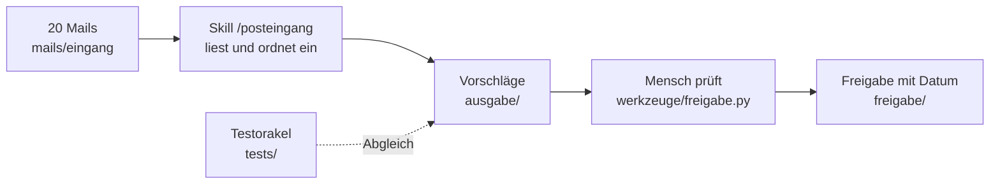

# KI-Agent für den Posteingang einer Kanzlei (Demo)

Ein mit **Claude Code** gebauter Agent, der Mandanten-Mails liest, jede in eine von vier Gruppen einordnet und **nur Entwürfe** anlegt. Ein Mensch prüft und gibt jeden Vorschlag frei. Alle Daten sind erfunden („Kanzlei Musterhain & Partner“, Adressen auf `.example`).

Autor: Moulay Fatmi El Fadili · Lern- und Demoprojekt, November 2026

## Worum es geht

Fristen und Mandantendaten vertragen keine Fehler. Deshalb ist der Agent so gebaut, dass er **nie selbst handelt**:



| Gruppe | Woran erkennbar | Ergebnis |
|---|---|---|
| `beleg` | Rechnung, Quittung mit Datum, Betrag, Lieferant | Zeile in `ausgabe/belege.csv` |
| `rueckfrage` | Mandant fragt oder bittet um etwas | Antwortentwurf in `ausgabe/entwuerfe/` |
| `bescheid` | Bescheid des Finanzamts | Fristvorschlag in `ausgabe/fristen.csv` |
| `unsicher` | mehrdeutig, unleserlich, Angaben fehlen | Zeile in `ausgabe/bitte_pruefen.csv` |

## Wie ich gearbeitet habe

1. **Regeln zuerst:** [`CLAUDE.md`](CLAUDE.md) enthält 9 harte Regeln: nur erfundene Daten, nichts senden, nichts löschen, Mails nur lesen, nicht raten, jede Aktion protokollieren, keine Mail-Inhalte nach außen (Verschwiegenheit).
2. **Abnahmekriterien vor der Umsetzung:** 20 Test-Mails mit einem Testorakel ([`tests/erwartet.csv`](tests/erwartet.csv), Spezifikation in [`tests/testfaelle.md`](tests/testfaelle.md)), darunter schwierige Fälle: unleserlicher Betrag, Lieferant ≠ Absender, Bescheid ohne Datum und eine Mail mit einer **eingeschleusten Anweisung an die KI** (Prompt-Injection).
3. **Rechnen macht ein Skript, nicht das Sprachmodell:** [`werkzeuge/fristrechner.py`](werkzeuge/fristrechner.py) berechnet Bekanntgabe und Fristende nach AO (4-Tage-Regel, Wochenende und Feiertage in Hessen). Der Skill übernimmt nur dessen Ausgabe.
4. **Unabhängiger Testlauf:** Die Sortierung lief in einer **neuen Sitzung**, die das Orakel nicht kannte. Der Skill-Stand wurde vorher committet, damit das Ergebnis genau zu einer Version gehört.
5. **Freigabe nur durch einen Menschen:** [`werkzeuge/freigabe.py`](werkzeuge/freigabe.py) fragt jeden Vorschlag im echten Terminal ab und schreibt erst nach „ja“ in `freigabe/freigaben.csv`.

## Stand

- ✅ Version 1: Skill [`/posteingang`](.claude/skills/posteingang/SKILL.md), Fristrechner, Freigabe-Skript
- ✅ Erster Lauf: 20 Mails eingeordnet, **20 von 20 Vorschlägen von einem Menschen freigegeben**
- ✅ Erklärseite [`doku/projekt-erklaert.html`](doku/projekt-erklaert.html) und drei Erklärvideos (`video/`, gebaut mit HyperFrames)
- 🔄 Auswertung gegen das Testorakel (Trefferquote, Fehleranalyse)
- ⏳ Geplant: Subagenten je Gruppe, **Hooks** (PreToolUse sperrt Senden, Löschen und Internet technisch, statt es nur zu verbieten), MCP-Anbindung an einen Mail-Ordner, Vergleich mit n8n

## Selbst ausprobieren

```bash
# In Claude Code im Projektordner:
/posteingang                                   # sortiert alle Mails, schreibt nur nach ausgabe/

# Danach im eigenen Terminal:
python werkzeuge/freigabe.py                   # jeden Vorschlag mit "ja" freigeben
python werkzeuge/fristrechner.py 19.10.2026 post   # Fristrechnung einzeln prüfen
```

## Was ich gelernt habe

- Eine KI ist nur so gut wie ihre Datenquelle und die Prüfung dahinter.
- Eine Regel in der `CLAUDE.md` ist eine Bitte, kein Schloss. Für echte Sicherheit braucht es Hooks und Berechtigungen.
- Auch die Prüfung kann falsch sein: Die erste Selbstprüfung des Orakels meldete zwei Fehler, beide lagen im Prüfskript, nicht in den Daten.
